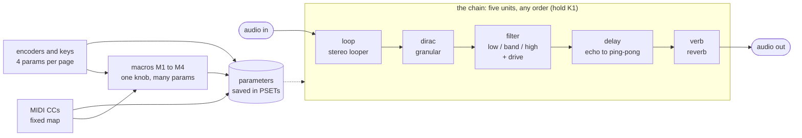

# dirac

A stereo instrument for monome norns built from ER-301 units: a **looper**,
the **Dirac** granular processor and the **Varia** filter, joined by a delay
and a reverb, in one chain you can reorder while it plays.

**v0.13.0 beta.** For norns and norns shield (32-bit norns images, which is all
of them today). Developed on a norns shield with a Raspberry Pi 4B.

[Install](#install) · [Playing it](#playing-it) ·
[Units and parameters](#units-and-parameters) · [MIDI](#midi)

## What it is

Audio comes in, runs through five units in a row, and goes out. You choose
the order: loop first and the grains chew on the loop, or put the loop last
and record what the grains, filter and echoes make. Reordering never
interrupts anything, so a loop keeps playing as it moves.



- **loop**: Noether, the ER-301 looper. Seamless loops, overdub, undo,
  speed and reverse, drawn as a reel.
- **dirac**: the ER-301 granular processor, on the live input or a sample,
  drawn as a field of grains.
- **filter**: Varia, the ER-301 variable-bandwidth filter, swept from
  lowpass through band to highpass, with resonance, extra peaks and drive,
  drawn as its response curve.
- **delay** and **verb**: a stereo delay and a reverb. Each costs nothing
  while its mix is at 0.
- **macros** move several parameters with one knob; you set them up by
  turning the parameters themselves. **MIDI** works with no setup: a fixed
  list of CCs reaches the macros and the main controls.

Every unit starts out of the sound (mix 0) except the loop and the grains,
so a fresh load sounds like a looper into Dirac.

### How it runs

Three layers: a Lua script draws the pages and handles the keys, macros
and MIDI; a SuperCollider engine runs the chain, each unit in its own slot,
so reordering moves units without restarting them; and three C++ plugins
do the ER-301 DSP. The looper and granular engines are the ER-301's own C++, copied unchanged;
the filter keeps Varia's code and adds the low-to-high sweep. The delay and
reverb are SuperCollider. The plugins come prebuilt and install themselves
the first time the script runs.

## Units and parameters

Every unit's pages, in the order E1 reaches them. Each page has two rows of
two; the screen shows the short label (in the second column), and the
default is in brackets after each range. Every parameter is also in the norns PARAMS menu,
under its full name.

### loop: Noether, the ER-301 looper

Stereo. With no loop recorded it passes the input straight through. Its
display is the **reel**: the loop as a ring whose thickness is its loudness.

| page | label | range (default) | what it does |
|---|---|---|---|
| loop | speed | −2 to 2 × (1) | Playback speed; pitch follows. Negative plays in reverse, 0 stops. Sticks gently at ¼, ½, 1 and 2×. |
| loop | level | 0 to 1 (1) | The loop's level. |
| loop | sos | 0 to 1 (0.5) | Sound-on-sound: how much of the old loop an overdub keeps. 0 replaces it, 1 keeps all of it. |
| loop | dry | 0 to 1 (1) | The live input's level alongside the loop. |
| dub | dub | press | Overdub in, or out if already overdubbing. |
| dub | ext | on / off (off) | Extend: an overdub that runs past the loop's end makes the loop longer. |
| dub | undo | press | Swap out the last overdub or extension. Again to redo. |
| dub | clear | press | Erase the loop. |
| (K3) | rec | press | One button for everything: record, close and play, overdub in, overdub out. |
| (K2) | stop | on / off (off) | Fade the loop out and hold its place; again to resume. |

### dirac: the ER-301 granular processor

Grains read from a 2.7 s buffer of whatever reaches it (or from a loaded
sample). Its display is the **field**: the buffer as a waveform, each grain
a bright bar where it reads, raised or lowered by its pitch.

| page | label | range (default) | what it does |
|---|---|---|---|
| grain | dens | 0 to 32 (3) | Density: how many grains overlap. 0 = grains only when fired (K3). |
| grain | len | 1 ms to 1 s (50 ms) | Grain length. |
| grain | grns | 1 to 32 (12) | The most grains allowed at once. |
| grain | rev | 0 to 1 (0) | Chance a grain plays backwards. |
| shape | shape | 8 shapes (normal) | Grain envelope: normal, bell, sinc, triangle, decay, ramp, tukey, square. |
| shape | tex | 0 to 1 (0.5) | Texture. On *normal* it morphs percussive → smooth → flat-topped; on the others it is that shape's own adjustment. |
| shape | tilt | −1 to 1 (0) | Where each grain peaks: −1 at its start, 0 in the middle, 1 at its end. |
| shape | tscat | 0 to 1 (0) | Gives each grain its own tilt around *tilt*, so attacks and swells mix. |
| scan | head | 0 to 1 (0) | Where grains read. Live: how far back in time (0 = now, which also sets the feedback delay). Sample: position in the file. |
| scan | jit | 0 to 1 (0) | Random scatter of each grain's read position. |
| scan | speed | −4 to 4 (0) | Sample only: scans through the file, independent of pitch. 1 = original tempo, negative = backwards. |
| scan | snap | 0 to 1 (0) | Pulls grains onto the nearest transient, so drums stay hits instead of a smear. |
| pitch | trans | −24 to 24 st (0) | Transpose, in semitones. |
| pitch | scat | 0 to 12 st (0) | Random pitch per grain, up to this many semitones. |
| pitch | scale | 7 options (off) | Snaps the scattered pitches to a scale: off, chromatic, major, minor, pentatonic major or minor, whole tone. |
| pitch | v/oct | −2 to 2 (0) | Fine, continuous pitch offset, added to transpose. |
| heads | multi | on / off (off) | Turns on up to four playheads sharing the buffer. Off bypasses them entirely. |
| heads | heads | 1 to 4 (1) | How many playheads; grains are dealt between them. |
| heads | hsprd | 0 to 1 (0) | How far apart the playheads read (1 = spread across the whole buffer). |
| heads | htune | −12 to 12 st (0) | Pitch interval between playheads: 7 gives stacked fifths, and with a *scale* set it builds chords in that scale. |
| space | sprd | 0 to 1 (0.5) | How far grains scatter across the stereo field. |
| space | binau | 0 to 1 (0) | Binaural depth on top of the panning (best on headphones). |
| space | dtune | 0 to 0.5 st (0) | Detunes left against right. |
| space | diff | on / off (off) | Diffuse: smears grain edges into a halo (and the feedback with them). |
| regen | fdbk | 0 to 1 (0) | Feeds the output back into the buffer: ~0.8 a clear tail, ~1 a held drone. |
| regen | comp | 0 to 1 (0) | Evens out grain levels, so quiet and loud source parts sit together. |
| regen | frz | on / off (off) | Freeze: stops recording into the buffer, so the grains keep playing a frozen moment. |
| regen | hold | on / off (off) | Hold: freezes the cloud itself (grains loop, no new ones). Also K2. |
| out | mix | 0 to 1 (1) | Dirac against what reaches it: 0 hears straight through it. |
| out | level | 0 to 1 (0.7) | Dirac's output level. |
| out | input | L+R / L / R (L+R) | Which input channel(s) Dirac hears: L or R alone suits a mono cable in one jack. |
| out | gain | −24 to 24 dB (0) | Gain on the norns input, before the whole chain. |
| file | src | live / sample (live) | Granulate the live input or a loaded sample. |
| file | file | a file | Load a sample (any rate; converted to 48 kHz the first time). |
| file | clear | press | Unload the sample and return to live. |
| file | save | press | Save Dirac's buffer (2.7 s) to `~/dust/audio/dirac/`. |
| (K3) | fire | press | Spawn grains now. |

### filter: Varia, the ER-301 variable-bandwidth filter, made multimode

Its display is its live response curve.

| page | label | range (default) | what it does |
|---|---|---|---|
| filter | freq | 20 Hz to 20 kHz (1 kHz) | Cutoff, or the centre of the band. |
| filter | res | 0 to 1 (0.3) | Resonance at the edges; self-oscillates at the top. |
| filter | type | low / band / high (low) | Sweeps continuously: lowpass → band (Varia itself) → highpass. |
| filter | width | 0 to 1 (0.5) | The band's width, up to 6 octaves. Does nothing at pure low or high. |
| peaks | mix | 0 to 1 (0) | The filter against what reaches it. At 0 the filter is out of the sound. |
| peaks | peaks | 0 to 1 (0) | Varia's extra resonant peaks inside the band: from 2 up to 7. Needs some *res*. |
| peaks | phase | −1 to 1 (0) | Swings the resonant peaks across the stereo field. |
| peaks | drive | 0 to 1 (0) | Pushes the signal into a soft saturator before the filter (up to +24 dB in). |

### delay

Stereo. Its display draws each echo as a tap, left above and right below.

| page | label | range (default) | what it does |
|---|---|---|---|
| delay | time | 10 ms to 2 s (375 ms) | Delay time; changes glide like tape. |
| delay | fdbk | 0 to 1 (0.45) | Feedback: how many repeats. Even at 1 it sustains rather than runs away. |
| delay | sprd | 0 to 1 (0.5) | 0 = the same echo on both sides, 1 = ping-pong. |
| delay | mix | 0 to 1 (0) | The delay against what reaches it. |

### verb

JPverb (FreeVerb if it is not installed). Uses no CPU while its mix is 0.
Its display shows the decay.

| page | label | range (default) | what it does |
|---|---|---|---|
| verb | verb | 0 to 1 (0) | The reverb's mix. |
| verb | time | 0.1 to 60 s (2 s) | Decay time. |
| verb | size | 0.5 to 5 (1.5) | Room size. |
| verb | damp | 0 to 1 (0.3) | Damping: higher darkens the tail faster. |

### macros

Reached past the last unit in the chain view (**mc**). *Macros*, under
Playing it, explains learning one.

| page | label | range (default) | what it does |
|---|---|---|---|
| macro | M1 | 0 to 1 (0) | *darker*: brings the filter in and down, damps the reverb. |
| macro | M2 | 0 to 1 (0) | *space*: brings the reverb and delay in, widens the delay. |
| macro | M3 | 0 to 1 (0) | Empty until you learn it. |
| macro | M4 | 0 to 1 (0) | Empty until you learn it. |

---

## Beta testers: start here

### Install

1. In maiden, run:

   ```
   ;install https://github.com/nickb808-dev/norns-dirac
   ```

2. Load **norns-dirac** from SELECT. The first time, it installs its SuperCollider
   plugin and shows **"engine installed. SYSTEM > RESTART"**.
3. Do **SYSTEM > RESTART**, then load **norns-dirac** again. You'll see the title
   screen, then the loop (the first unit in the chain).

An update that changes the engine shows the same screen once, and needs one
more restart. Updates that don't change the engine load straight away.

### Playing it

Plug a source into the norns input. It runs through a **chain of five
units**, in whatever order you like:

**loop**, **dirac**, **filter**, **delay** and **verb**. Every page and
parameter is listed under [Units and parameters](#units-and-parameters).

The default chain is loop → dirac → filter → delay → verb, with the filter,
delay and reverb off (mix 0), so it sounds as it always has until you turn
them up.

**Hold K1 to see the chain.** E1 picks a slot, E2 or E3 carries its unit
left or right; release K1 to apply. Changes crossfade, and every unit keeps
what it was doing as it moves (a loop keeps playing). To take a unit out of
the sound, turn its mix down. The order is saved with PSETs.

**Macros.** Past the last unit in the chain view (E1 all the way right) is
**mc**, the macro page: four knobs, M1 to M4, each moving several
parameters at once, each between its own two settings. M1 (*darker*: filter
in and down, reverb damped) and M2 (*space*: reverb and delay in, wider)
come filled; M3 and M4 are empty.

To make your own: on the macro page, pick a macro (E1 / E2 / E3 select it,
underlined) and press **K3**. *learn M3* shows on every page. Now go to any
unit and turn the parameters you want the macro to move, from where they
are to where the macro's far end should be. Press **K3** again to finish.
Where each parameter started is the macro at 0, where you left it is the
macro at 1. Learning a macro again replaces what it moves; a parameter
turned and put back where it was is dropped. Macros save with PSETs.

**Every page shows four parameters**, in two rows. The bright row is the one
E2 and E3 turn; **E1 steps the bright row** (top, bottom, then on to the
unit's next page). Labels are short; the full name of whatever you turn
shows on the page line for a moment. The page line also shows the chain,
with the slot you're on bright.

**The loop pages** (`loop`, `dub`) show the **reel**: the loop as a ring whose
thickness is its loudness, 12 o'clock the seam, clockwise forward. The head is
a dot with a tail that grows the further speed is from 1x, and turns into a
small hollow ring on 1/4, 1/2, 1 or 2x (or 0, or any of them reversed).
Recording winds the ring on from 12 o'clock.

| control | on the loop pages |
|---|---|
| K3 | rec: empty → record → close and play → overdub in → overdub out |
| K2 tap | stop the loop on/off (it fades out and holds its place) |
| K1 held + K2 | undo the last overdub (again = redo) |

The loop closes on the sample you pressed, phase-matched and blended so it
wraps without a click at any speed or direction. *sos* sets how much of the
old loop an overdub keeps; *extend* lets an overdub past the end grow the loop.

**The grain pages** show the **field**: the live buffer as a waveform, with
"now" at the right edge, and each grain as a bright bar where it is reading,
raised or lowered by its pitch.

| control | does |
|---|---|
| E1 | row, then page, within the slot's unit |
| K1 held | the chain: E1 slot, E2/E3 move it, release to apply |
| E2 / E3 | the two parameters in the bright row |
| K2 held + E2/E3 | fine adjust |
| K1 held + K3 | rec, from any page (the field shows *rec* / *dub* while it runs) |
| K2 tap | hold the cloud on/off |
| K3 | fire: spawn grains now (at density 0, the only way they spawn) |
| K1 held + K2 | field shows stereo position instead of buffer position |
| K2 held + K3 | mutate (any page): see below |

| control | on the macro page |
|---|---|
| K3 | learn the selected macro; K3 again (on any page) to finish |

**Mutate: hold K2 and press K3.** Every continuous control of the unit on
screen moves a random amount (up to a quarter of its range) from where it
is, so pressing again wanders further. On the macro page it mutates every
unit at once. Mixes, levels and input gain never move, and the feedback
controls and filter resonance stop short of running away, so a mutation
changes the sound without dropping it out or blowing it up. Save a PSET
first if you might want to get back.

**mix** (out page) blends Dirac against the looper's stereo output: turn it
down to hear the loop itself. *save capture* on the file page saves Dirac's
buffer (2.73 s) to `~/dust/audio/dirac/`.

Dimmed parameters do nothing in the current state (for example, speed in live
mode, head spread with multi off, or undo with nothing to undo). Every
parameter is also in **PARAMS**, for MIDI mapping and PSETs.

### MIDI

Plug in a controller; pick it in PARAMS > *midi device* (and a channel, or
*omni*). These CCs work with no setup. Whatever you turn shows its full
name on the page line, so you can check a mapping by moving it.

| CC | controls | | CC | controls |
|---|---|---|---|---|
| 16 | macro M1 | | 26 | filter res |
| 17 | macro M2 | | 27 | filter type |
| 18 | macro M3 | | 28 | filter drive |
| 19 | macro M4 | | 29 | filter mix |
| 20 | loop level | | 30 | delay time |
| 21 | loop speed | | 31 | delay feedback |
| 22 | dirac mix | | 85 | delay mix |
| 23 | dirac density | | 86 | reverb mix |
| 24 | grain length | | 87 | reverb time |
| 25 | filter freq | | | |

Buttons (a CC sent at 64 or above, as most pads and buttons do):

| CC | does |
|---|---|
| 102 | loop rec / close / overdub |
| 103 | loop stop on/off |
| 104 | loop undo |
| 105 | dirac fire |
| 106 | dirac hold on/off |

The macros are the best things to put on knobs: one CC moves a whole
gesture. For anything else, norns' own MIDI mapping still works (PARAMS >
MAP); avoid giving a CC both meanings.


**Files:** on the **file** page, turn E3 on *sample* to open the browser and
pick a file from `~/dust/audio`. Files that aren't 48 kHz are converted once
(into `~/dust/audio/dirac/.cache/`). *source* switches between live input and
the sample. Saved buffer captures load straight back in as samples.

### Known issues

- One brief click when the script loads, while the engine allocates its
  memory.
- Converting a long non-48 kHz file takes a few seconds the first time.
- In sample mode the waveform shows the file, not the regeneration buffer
  that feedback writes into.

### Reporting a problem

Please include:

- what you did, what you expected, and what happened;
- your norns (official or shield, and which Pi) and its norns version;
- if anything errored, maiden's output after loading norns-dirac.

### If you SSH into a norns shield

Set `RemoveIPC=no` in `/etc/systemd/logind.conf` and reboot. Without it,
every SSH logout deletes JACK's shared memory, and audio connections break in
ways that look like script bugs. (Only matters if you log in over SSH.)

### Building the engine yourself

Only needed on a 64-bit norns image, or to work on the code: on the norns,

```
cd ~/dust/code/norns-dirac/ugen && make install
```

then SYSTEM > RESTART. `make install` marks the engine as a source build, so
the script won't replace it with the prebuilt one.

---

## How it is built

The Dirac and Noether engines are **vendored verbatim** from their ER-301
repos, not reimplemented: the same C++ that runs on the ER-301 runs here,
wrapped as SuperCollider UGens and driven by a Lua script. `make
verify-vendor` fails on any local edit. The filter is derived from Varia and
tested against it (bit-identical in its band setting); see
`ENGINE-PROVENANCE.md`.

That is the design constraint: **one engine, ported.** A SuperCollider
rewrite would fork the DSP and every fix would have to be made twice.

## Phase 0 — what is done, and what proves it

```
make check
```

runs four gates:

| gate | what it proves |
|---|---|
| `verify-vendor` | `engine/` is byte-identical to the upstream ER-301 source |
| `shimtest` | the vendored engine compiles against `norns/od/` — a THIRD implementation of the six `od::` symbols, after the ER-301's and the host harness's |
| `hosttest` | all 17 ported ER-301 suites pass here |
| `reference` | this build renders `ident` **bit-for-bit** identical to the canonical engine |

That last one is the important one. `test/reference/ident-v0.2.12.bin` is the
canonical engine's output for a set of deterministic scenarios — fixed RNG
seed, fixed control values, live and sample mode. It is **the acceptance test
for Phase 1**: when the UGen exists, render the same scenarios through it in
non-realtime on the Pi and diff against this file.

Correctness of this port is a byte comparison, not a listening test.

## Layout

```
engine/          vendored Dirac.{h,cpp} — DO NOT EDIT (see ENGINE-PROVENANCE.md)
norns/od/        the shim: the six od:: symbols, for SuperCollider (163 lines)
test/host/       the ported ER-301 harness, unchanged from upstream
test/reference/  the canonical ident render
docs/            NORNS-PORT.md — platform notes, interface design, the plan
ugen/            (Phase 1) scsynth plugin wrapper
lib/             (Phase 2) Engine_Dirac.sc
norns-dirac.lua  the script
```

## The shim, and the one real difference

`norns/od/` mirrors the ER-301's surface, with one structural change:

**Ports do not own their buffers.** On the ER-301 a `Port` carries
`float mBuf[FRAMELENGTH]`. Under scsynth the audio lives in the graph's wires —
`IN(n)` / `OUT(n)` return pointers the server owns, which can move between
calls. So a `Port` here is a named pointer the wrapper re-points every block.
The engine never notices: it only calls `buffer()`, and it re-reads that every
block already.

An unconnected inlet points at a shared zero block, matching the ER-301
firmware (`Inlet::buffer()` returns `ZeroOutput.buffer()` when nothing is
patched). Several exact-bypass behaviours depend on that reading as real zeros
rather than null.

## Known unknowns, carried into Phase 1

- **Block size.** `FRAMELENGTH` is 128 on the ER-301 and several per-block
  budgets are tuned to it (`kSnapPerBlock`, grain spawn decisions). scsynth's
  block size is a server setting. Build with `-DFRAMELENGTH=<n>` once the real
  value is known — and expect the `reference` diff to catch a mismatch.
- **`mCapBuf` is 512 KB and must come from `RTAlloc`**, not `std::vector`:
  scsynth forbids allocation on the audio thread. The engine never allocates in
  `process()`; the risk is the constructor path.

## Licence

Apache-2.0. See `LICENSE` and `NOTICE`. Engine © Nick Breinich (nickb808).
